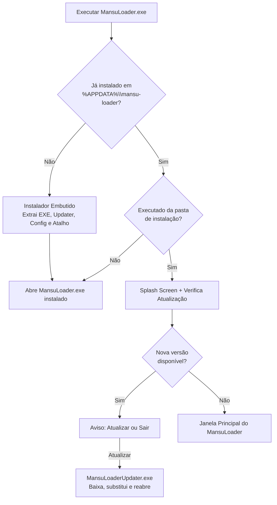

<div align="center">


# 🎵 MansuLoader

**Baixe músicas do YouTube em MP3 na máxima qualidade com pré-visualização instantânea, instalador embutido e atualização automática.**


[](https://github.com/iJeanClaud/MansuLoader/releases/latest)

<br />


</div>

---

## ✨ Recursos Principais

| Recurso | Descrição |
| :--- | :--- |
| 🎨 **Interface Moderna** | Tema escuro em `CustomTkinter` com barra de título integrada (Minimizar e Fechar), centralizada e em primeiro plano ao abrir. |
| ⚡ **Pré-visualização Automática** | Ao colar um link (inclusive via **botão direito → Colar**), carrega automaticamente capa, título, canal e duração com animação de carregamento no botão. |
| 🎧 **Qualidade Máxima (MP3)** | Extração do melhor áudio disponível (`bestaudio/best`) com **FFmpeg embutido**, convertendo para **320 kbps** (ou 256, 192 e 128 kbps) com metadados. |
| 📁 **Pasta Personalizada** | Salva a pasta de destino em `%APPDATA%\mansu-loader\config.json` e solicita o local automaticamente caso ainda não esteja definido. |
| 🛡️ **Verificação de Duplicidade** | Detecta antes do download se o arquivo `.mp3` já existe na pasta escolhida, exibindo aviso com fechamento automático em 20s. |
| ▶️ **Modal de Conclusão** | Ao terminar, zera a prévia e a barra de progresso e oferece os botões **Reproduzir** e **Fechar** (com timer automático de 20s). |
| 📦 **Instalador Embutido** | Na primeira execução, instala automaticamente em `%APPDATA%\mansu-loader\`, cria atalho na Área de Trabalho e inicia o aplicativo. |
| 🔄 **Atualização Automática** | Verifica novas versões na branch `main` antes de abrir o app e aciona o `MansuLoaderUpdater.exe` para atualizar e reiniciar automaticamente. |
| 🩺 **Registro de Logs e Crashes** | Registra exceções e falhas nativas (`faulthandler`) em `%APPDATA%\.mansu-loader\crash.log`. |

---

## 🧭 Fluxo de Execução



---

## 📥 Download e Uso (Windows)

1. Acesse a página de [**Releases**](https://github.com/iJeanClaud/MansuLoader/releases/latest) e baixe o **`MansuLoader.exe`**.
2. Execute o **`MansuLoader.exe`** — na primeira vez, ele fará a instalação automática em `%APPDATA%\mansu-loader\` e criará um atalho na sua **Área de Trabalho**.
3. **Não é necessário instalar Python, `yt-dlp` ou FFmpeg separadamente**: tudo já vai embutido no executável único.

---

## 🛠️ Desenvolvimento e Compilação

### Pré-requisitos (apenas para compilar do código-fonte)
- **Python 3.13+**
- **FFmpeg** instalado em `C:\ffmpeg\bin\ffmpeg.exe` (ou no `PATH`)

### Executando localmente
```powershell
python -m venv .venv
.\.venv\Scripts\python.exe -m pip install -r requirements.txt
.\.venv\Scripts\python.exe main.py
```

### Executando os testes unitários
```powershell
.\.venv\Scripts\python.exe -m unittest discover -s tests -v
```

### Gerando o executável standalone (`dist\MansuLoader.exe`)
```powershell
powershell -ExecutionPolicy Bypass -File .\build_exe.ps1
```

---

## 📂 Estrutura do Projeto

```text
MansuLoader/
├── .github/workflows/
│   └── release.yml          # Build e publicação automática no GitHub Releases
├── assets/
│   ├── mansuloader.ico      # Ícone multi-resolução do executável
│   ├── mansuloader.png      # Logo PNG transparente
│   └── splash.png           # Imagem da splash screen
├── scripts/
│   └── prepare_assets.py    # Geração e tratamento dos ícones e splash
├── src/
│   ├── config_manager.py    # Leitura/escrita segura de config.json
│   ├── installer.py         # Instalador inicial e atalho na Área de Trabalho
│   ├── logger.py            # Log rotativo e faulthandler em crash.log
│   ├── update_service.py    # Verificação de versão e validação HTTPS
│   ├── version.py           # Versão atual e URLs do repositório
│   ├── youtube_service.py   # Validação de URL, prévia e conversão MP3
│   └── ui/
│       └── app.py           # Interface gráfica principal (CustomTkinter)
├── tests/
│   └── test_core.py         # Testes unitários automatizados
├── build_exe.ps1            # Script de build do Updater + MansuLoader.exe
├── main.py                  # Ponto de entrada, splash e pré-verificação
├── updater_main.py          # Executável independente de atualização
├── requirements.txt         # Dependências Python
└── version.json             # Manifesto remoto de versão na branch main
```

---

## 🔒 Segurança

- **Allowlist estrita de domínios:** aceita apenas links `http`/`https` oficiais do YouTube (`youtube.com`, `youtu.be`, `music.youtube.com`) para download e apenas `https://` do GitHub (`github.com`, `raw.githubusercontent.com`, `objects.githubusercontent.com`, `release-assets.githubusercontent.com`) para atualizações.
- **Validação de executável:** verifica cabeçalho PE (`MZ`) e tamanho mínimo antes de substituir o `.exe` durante uma atualização.
- **Proteção de caminhos:** sanitiza nomes de arquivos e valida que o `.mp3` gerado permanece dentro da pasta de destino escolhida.
